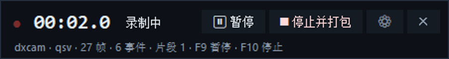
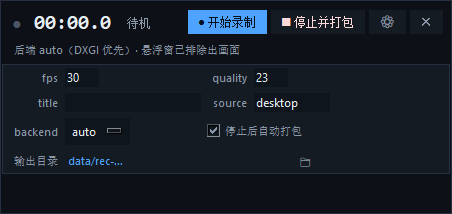

# Desktop Trajectory Studio (D Studio)

D Studio is a Windows desktop recorder for operator-started CAD and computer-use sessions. It records video and keyboard/mouse activity while recording is active. Recordings and exports stay on the operator’s computer until they choose to share them. Use it with the knowledge and consent of the person recording.

## Run on Windows

1. Install 64-bit Python 3.12 with Tk and add it to `PATH`. Install FFmpeg and FFprobe and add them to `PATH`.
2. Extract the source archive or clone this repository. Run `INSTALL.bat` to set up the local Python environment, then run `SELFTEST.bat` to check it.
3. Run `START-OVERLAY.bat`. In Settings, choose **App only** and select your app if you want to limit capture. Record a short test and stop with **F10**. Select **Export recording** to save the video, event logs, metadata and a narration template. The export uses Markov’s CAD clip-set file layout. Event fields vary across reference samples.

For a per-user Windows installer or a portable ZIP, use the [Windows build instructions](installer/README.md). See the [quick-start guide](DStudio-Quick-Start.txt) for using a built package.

D Studio’s own source code is [MIT licensed](LICENSE). The bundled Inno Setup translation retains its [upstream license](installer/lang/LICENSE.txt). The [installer documentation](installer/README.md) identifies separate third-party dependencies.

**v0.2 (2026-11-18)** — 使用者请看 [使用说明.md](使用说明.md)（中文 / English）；CAD 交付请看
[CAD交付检查说明.txt](CAD交付检查说明.txt)。
End users: see [使用说明.md](使用说明.md) (Chinese / English); CAD delivery: [CAD交付检查说明.txt](CAD交付检查说明.txt).

| v0.2 | 中文 | English |
|---|---|---|
| 安装 / Install | `DStudio-Setup-0.2.1.exe`（按用户安装、无需管理员、内置 Python + FFmpeg）或免安装 zip | per-user Setup.exe (no admin, bundles Python + FFmpeg) or portable zip |
| 仅应用 / App only | 整屏分辨率，非目标窗口实时涂黑；切走自动暂停（`privacy_mask_start/end`） | full-monitor frame, every non-target window painted black live; auto-pause when another app is in front |
| 光标 / Cursor | 默认画进视频（DXGI 精灵混合 / GDI DrawIconEx / gdigrab） | drawn into the video by default |
| 帧率 / FPS | 30（Markov 标准）或 60，`--fps 1..120` | 30 (Markov) or 60 |
| 界面 / UI | 录制条、表单、应用选择、标注台、安装包、自检均为中英双语，可随时切换 | recorder bar, forms, app picker, annotator, installer and self-test in both languages |
| 导出 / Export | `↓ 导出录制` / `python -m packager.export_cad --recording-only` 输出 Markov 5 文件剪辑集 | Markov 5-file clip set without narration/rubric |
| 后端 / Backends | `auto`（DXGI → GDI）、`dxcam`、`gdi`（新，纯 ctypes BitBlt）、`gdigrab` | |

成片为 `clip.mp4`（下文旧示例中的 `video.mp4` 是旧版名称，标注台仍兼容）。高精度同步和真实长任务仍需实测验收。

一个给「AI 训练用桌面操作数据」用的采集 + 打包 + 标注工具链。产出的交付包与
[Markov Studios `general-computer-use`](https://www.markovstudios.com/datasets/general-computer-use/resolve-sky-replacement-935a9eec)
的数据格式对齐（`events.json` / `frame_events.json` / `metadata.json` / `narration.json`），
采集思路参考 [`open-world-agents/ocap`](https://github.com/open-world-agents/ocap)。

## 四条需求的落点

| 需求 | 实现 |
|---|---|
| ① 录屏 + 光标（本体 + 拖尾） | v0.2 起光标默认画进视频（与 Markov 一致，`--no-draw-mouse-cursor` 关闭）；`viewer` 叠加拖尾/点击涟漪；`tools/burn_overlay.py` 可为无光标的旧录像烧录 |
| ② 全部输入 + 与视频时钟同步 | `recorder`：`WH_MOUSE_LL`/`WH_KEYBOARD_LL` + QPC 时间戳；ffmpeg `showinfo` 产出逐帧墙钟 sidecar |
| ③ 工程师标注平台 → narration.json | `viewer`：视频 + 事件时间轴 + 自动预分割 + 段落编辑 + 校验闸门 + 草稿自动保存 |
| ④ 帧级对齐每个输入 | `packager`：墙钟 → `video_t_ms` → 帧分桶，合成每帧光标/按键状态 |
| ⑤ metadata.json | `packager`：clip 表（含暂停空洞 `gap_before_ms`）、帧数、事件数、fps |

## 目录

```
recorder/   采集端（Windows，纯标准库，视频走 ffmpeg）
packager/   离线打包：raw → 交付包（可反复重跑，不用重录）
viewer/     标注平台（静态站，无构建步骤）
tools/      serve.py（静态站+保存 API）/ burn_overlay.py / make_demo.py
schemas/    4 个交付文件的 JSON Schema
docs/       数据格式规范、架构设计、路线图
tests/      端到端不变量测试
data/<id>/  一个交付包 = 一个目录
```

## 快速开始（不用真录，先跑通全链路）

```bash
pip install pillow                        # 仅烧录光标时需要
python tools/make_demo.py --out data/demo # 合成 14s 演示数据（ffmpeg 测试图）
python tools/serve.py --open              # 打开 http://127.0.0.1:8000/viewer/
```

在标注台里：点「自动预分割」→ 逐段填 `action / intent / app / details` →
「导出 narration.json」（同时写回 `data/demo/narration.json` 与本地草稿）。

## 悬浮窗录制（日常推荐）

双击 `overlay.bat`，或：

```bash
python -m recorder gui
```

屏幕顶部中间会出现一个悬浮条：



- `● 开始录制` / `⏸ 暂停` / `■ 停止并打包`，`⚙` 展开设置（fps / quality / title / source / backend / 是否自动打包），`✕` 关闭
- 悬浮条用 `SetWindowDisplayAffinity(WDA_EXCLUDEFROMCAPTURE)` 从画面里排除，**不会录进视频**（DXGI 后端；gdigrab 下系统可能仍会录到，UI 会提示）
- 停止后自动跑 packager，状态变「已打包」，点「↗ 打开标注台」直接跳到该数据集
- 录制中 `F9` 暂停/继续、`F10` 停止（全局热键，不用点窗口）
- 输出到 `data/rec-日期-时间/`，`📁` 打开目录



命令行等价：

```bash
python -m recorder start --out data/rec-001 --fps 30
```

## 真实录制

```bash
# 默认整屏 30fps；F9 暂停/继续，F10 结束（或 Ctrl+C）
# backend=auto：有 bettercam 就用 DXGI 桌面复制，否则回退 ffmpeg gdigrab
python -m recorder start --out data/rec-001 --fps 30

# 只录某个显示器 / 某个窗口 / 某个区域
python -m recorder start --out data/rec-002 --source monitor:1
python -m recorder start --out data/rec-003 --source "window:DaVinci Resolve"
python -m recorder start --out data/rec-004 --source region:0,0,1920,1080

# 硬件编码优先 nvenc，找不到自动回退 amf/qsv/libx264
# （auto 会先用 3 帧试编码验证，避免选到「已编译但没驱动」的编码器）
python -m recorder start --out data/rec-005 --codec auto --quality 20

# 冒烟测试：录 6 秒自动停
python -m recorder start --out data/smoke --max-seconds 6
python -m packager.build --raw data/smoke/raw --out data/smoke

# 强制指定采集后端 / 选择 DXGI 输出（多显示器）
python -m recorder start --out data/rec-006 --backend dxcam --dxcam-output 0
python -m recorder start --out data/rec-007 --backend gdigrab
```

### 采集后端

| | `dxcam`（DXGI Desktop Duplication，via bettercam） | `gdigrab`（ffmpeg） |
|---|---|---|
| 每帧时间戳 | 采集线程自己打（无锚点误差） | 从 `showinfo` 反推锚点 |
| 掉帧 | 可感知，用重复帧维持 CFR，并记录真实采集时刻 | ffmpeg 静默补帧 |
| CPU | 少一次 GDI 全屏拷贝 | 每帧 GDI 拷贝 |
| 依赖 | `pip install bettercam`（+ 可用 DXGI 的 GPU） | 只需 ffmpeg |
| 单窗口录制 | ✗（只能整屏/区域） | ✓ `--source "window:标题"` |
| 独占全屏/锁屏 | 可能停帧 → 自动切新 clip | 通常正常 |

`--backend auto`（默认）会先试 DXGI，失败自动回退 gdigrab，并写进 `capture.json` 的
`backend` / `backend_detail`（含 `duplicated_slots`、`observed_fps`）。
DXGI 帧本身不含光标，v0.2 在采集线程里把当前光标位图混合进每一帧（`recorder/cursor_draw.py`）；`gdi` 后端用 `DrawIconEx`，`gdigrab` 用 `-draw_mouse 1`。
“仅应用”模式需要逐帧在 Python 中涂黑，只能用 `dxcam` / `gdi`（`auto` 自动选择），`gdigrab` 会被拒绝。

产出 `data/rec-001/raw/`：`events.jsonl`、`segments.json`（含每帧墙钟）、
`capture.json`、`segments/seg_*.mp4`。暂停/恢复会产生多个 segment，空洞天然被剪掉。

打包成交付包：

```bash
python -m packager.build --raw data/rec-001/raw --out data/rec-001 \
  --id rec-001 --title "Resolve Sky Replacement" --category video-editing
```

可选：把光标烧进成片（母带不动，可反复重做）

```bash
python tools/burn_overlay.py --dataset data/rec-001 --out data/rec-001/video_cursor.mp4
```

## 交付包

```
data/<id>/
  clip.mp4             CFR 成片（暂停空洞已剪掉；旧版名为 video.mp4）
  metadata.json        帧数/时长/fps/clip 表
  events.json          JSONL 全速率事件（~1kHz 鼠标）
  frame_events.json    JSONL 一帧一行，含每帧合成光标状态
  narration.json       人工标注（viewer 产出）
  capture.json         录制端信息（backend、编码器、暂停时长、隐私遮罩时长、DXGI 统计…）
  view/mouse.jsonl     每帧光标（标注台低带宽索引）
  view/events.jsonl    离散事件索引（点击/按键/滚动/窗口）
  view/geometry.json   屏幕像素 → 视频像素映射（多屏/区域录制必需）
  raw/                 原始采集（保留，便于改 schema 后重新打包）
```

字段级规范（含实测校验的映射公式）：[`docs/data-format.md`](docs/data-format.md)。
架构与取舍：[`docs/architecture.md`](docs/architecture.md)。

## 时间同步怎么保证

1. 事件时间戳取 `perf_counter()`（QPC），同时记录墙钟与 `GetTickCount64`；
2. ffmpeg 每输出一帧都会打印 `showinfo` 的 `n/pts_time`，采集端按到达时刻锚定，
   得到**逐帧墙钟 sidecar**（`segments.json.frames`）；
3. 打包时 `video_t_ms = clip.frame_start*1000/fps + (event.timestamp - clip.source_start_ms)`，
   clip 内不足一帧的尾事件按 `t_in_frame_ms` 保留；
4. 帧分桶用 sidecar 的墙钟窗口（而不是 clip 数学），所以每帧的合成光标状态与同帧事件永远自洽。

实测参考数据时发现：仅用 `metadata.clips` 反推会产生 ~50ms 误差，因此本项目强制落 sidecar。
若发现整体偏移，用 `--sync-latency-ms` 校准（录几次点击，在标注台看涟漪是否对上界面反馈）。

## 标注平台

- 自动预分割：鼠标空闲 > 2s 或前台应用切换处切段，工程师只做合并/微调/填写
- 段落不重叠、按时间排序、导出前校验：空 `action`、重叠、非法区间会阻止导出；
  覆盖率 < 95% 给出告警
- 草稿自动保存到 `data/<id>/draft.json` + localStorage，刷新不丢
- 只读 `view/*.jsonl`（几百 KB～几 MB），不加载 200MB+ 的 `events.json`

## 测试

```bash
python -m unittest discover -s tests -v
python tests_windows/run_unit.py          # tests/ + 安装器/启动器测试（CI 使用）
```

Windows 真机端到端测试（录制 30/60fps、仅应用涂黑 + 自动暂停、F9/F10、导出 5 文件、安装/自检/卸载）
在 GitHub Actions `windows-latest` 上运行，见 `.github/workflows/windows.yml` 与 `tests_windows/`。

覆盖：帧数/时长自洽、clip 无缝、每帧合成光标、事件 `video_t_ms` 与文档公式一致、
暂停空洞内事件被丢弃但光标状态延续、预录事件落到第 0 帧、拖拽状态、重复打包幂等。

## 依赖

- Python 3.11+
- ffmpeg / ffprobe：安装版自带；开发环境放 PATH 或用 `DSTUDIO_FFMPEG` 指定
- 可选：`bettercam`（DXGI 采集后端，`pip install bettercam`）
- 可选：Pillow（烧录光标）、Playwright（自动截图回归，非必需）

## 已知限制

- 仅 Windows（`gdigrab`/DXGI + LL 钩子）；Linux/macOS 可复用 `packager`/`viewer`，采集端需另写
- bettercam 启动时会打一行 `Screen Capture FPS: N`，属其内部输出，不影响数据
- 窗口录制时窗口尺寸变化会导致编码器要求偶数宽高，已用 `pad` 过滤兜底；极端情况建议整屏录制
- 音频仅支持 dshow 设备（如 VB-Cable / Stereo Mix），未做 AEC
- “仅应用”模式会在编码前把非目标窗口涂黑；全屏模式下的密码管理器黑名单仍只记录区间 + 事件（不自动打码）
- 以管理员身份运行的 CAD 软件：非管理员的 D Studio 收不到其键鼠事件，需同样以管理员运行
